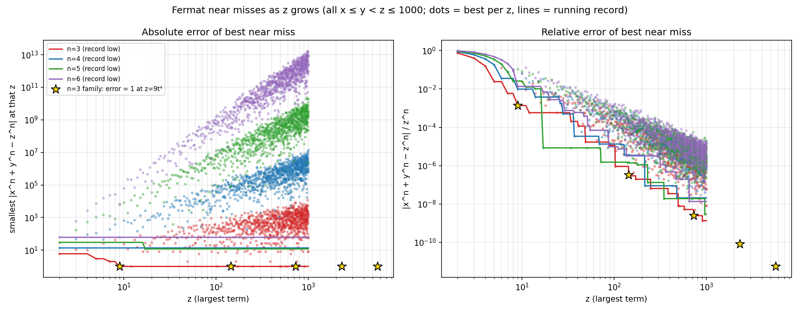

# So close to Fermat’s Last Theorem

An interactive web page that shows how close whole numbers can come to solving
**x<sup>n</sup> + y<sup>n</sup> = z<sup>n</sup>**, even though Fermat’s Last
Theorem (proved by Wiles and Taylor in 1995) says there are no exact solutions
for n ≥ 3.

**Live page:** `[https://<your-username>.github.io/<repository-name>/](https://neelsoumya.github.io/fermat-near-misses/)`



## What is on the page

- **Try it yourself:** enter x, y and n; the page finds the closest z and shows
  the gap. Exact big-integer arithmetic, so very large inputs work.
- **Live explorer:** choose n = 2–6 and a maximum z up to 400. Every triple is
  computed in your browser and the best miss at each z is plotted on log axes,
  as relative or absolute error.
- **Plain-language explanation** of why relative error shrinks as numbers grow
  (more combinations to choose from) while absolute error stays tiny only for
  n = 3 (the identity `(9t⁴ − 3t)³ + (9t³ − 1)³ = (9t⁴)³ − 1`).

The page is a single static file with no build step, no dependencies and no
external requests. It follows the visitor’s light or dark mode.

## Deploy on GitHub Pages (about two minutes)

1. Create a new **public** repository on GitHub (any name).
2. Upload everything in this folder to the repository root, or from a terminal:
   ```bash
   git init
   git add .
   git commit -m "Initial commit"
   git branch -M main
   git remote add origin https://github.com/<your-username>/<repository-name>.git
   git push -u origin main
   ```
3. In the repository go to **Settings → Pages**. Under **Build and deployment**
   set **Source** to **Deploy from a branch**, choose **main** and **/ (root)**,
   then **Save**.
4. After a minute the site is live at
   `https://<your-username>.github.io/<repository-name>/`.

Optional: if you prefer **Source = GitHub Actions**, the workflow in
`.github/workflows/pages.yml` can be run from the **Actions** tab.

## Preview locally

```bash
python3 -m http.server 8000
# then open http://localhost:8000
```

## Repository layout

```
index.html                     the whole interactive page
404.html                       simple not-found page
.nojekyll                      tells GitHub Pages to serve files as they are
assets/near_miss_magnitude.png figure used in this README
analysis/                      Python scripts behind the numbers
  near_miss_plot.py              regenerates the figure
  check_identities.py            verifies the n = 3 family and the AP reduction
  requirements.txt
notes/                         investigation logs (Markdown)
.github/workflows/pages.yml    optional Actions deployment
LICENSE                        MIT (replace [Your Name])
```

## Reproduce the analysis

```bash
cd analysis
python3 -m venv .venv && source .venv/bin/activate
pip install -r requirements.txt
python near_miss_plot.py        # writes analysis/output/near_miss_magnitude.png
python check_identities.py
```

## About the mathematics

- For n = 2 exact solutions exist (3² + 4² = 5²). For n ≥ 3 there are none.
- At each z there are about z² pairs (x, y), so the best relative error is
  about 1/z². A fit on z ≤ 800 gave log-log slopes of −2.1 to −2.2 for
  n = 3, 4, 5.
- Small relative error is cheap and says nothing about whether an exact
  solution exists. Equality is what the theorem rules out.
- The heuristic count of near misses with fixed absolute error diverges for
  n = 3 and converges for n ≥ 4. This is a heuristic, not a theorem.

## Limits

The explorer uses ordinary floating-point numbers, which are exact only below
about 9 × 10¹⁵, so z is capped at 400 for n up to 6. The “Try it yourself” box
uses exact big integers and accepts x, y up to 99,999 and n up to 20.

## License

MIT. See `LICENSE`.
